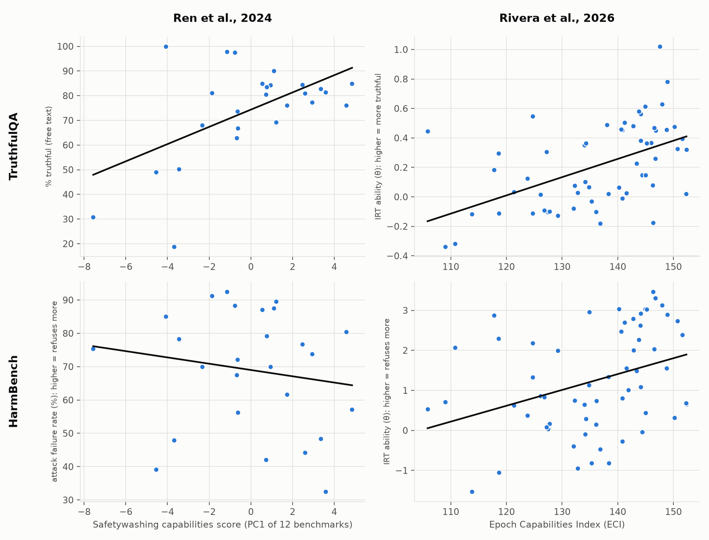
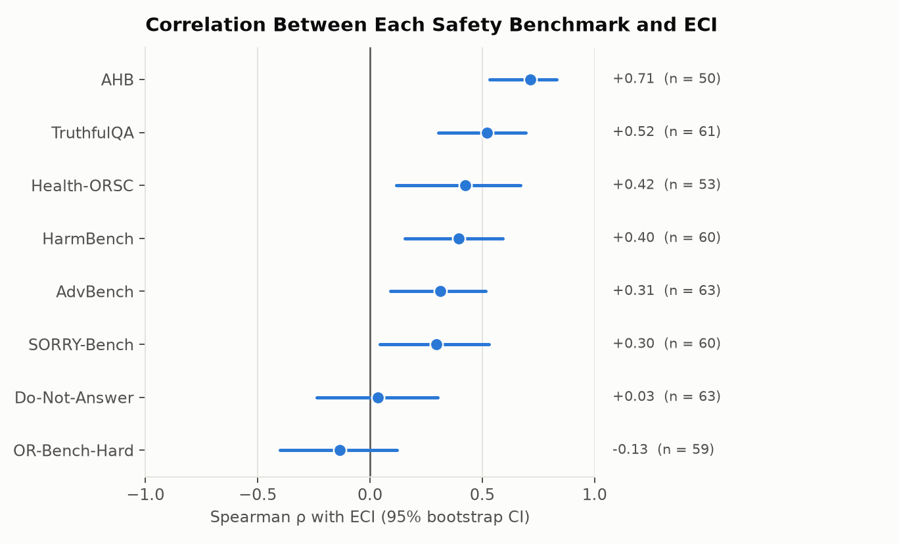
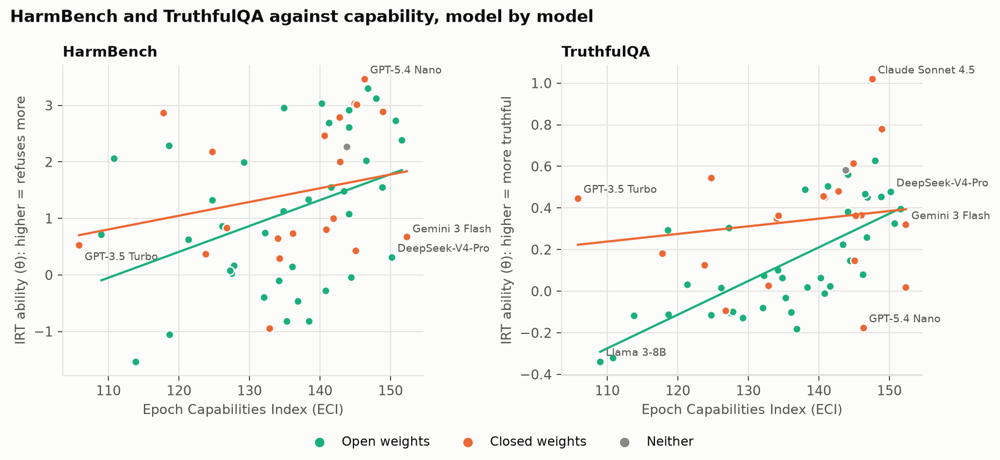
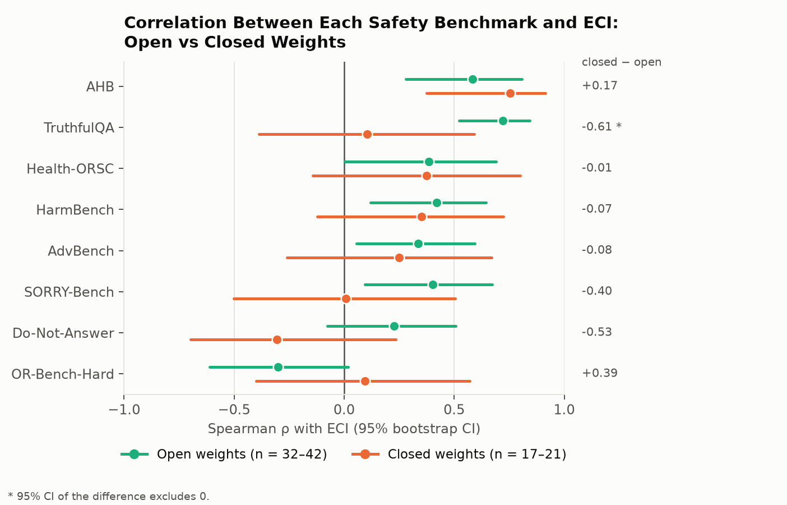
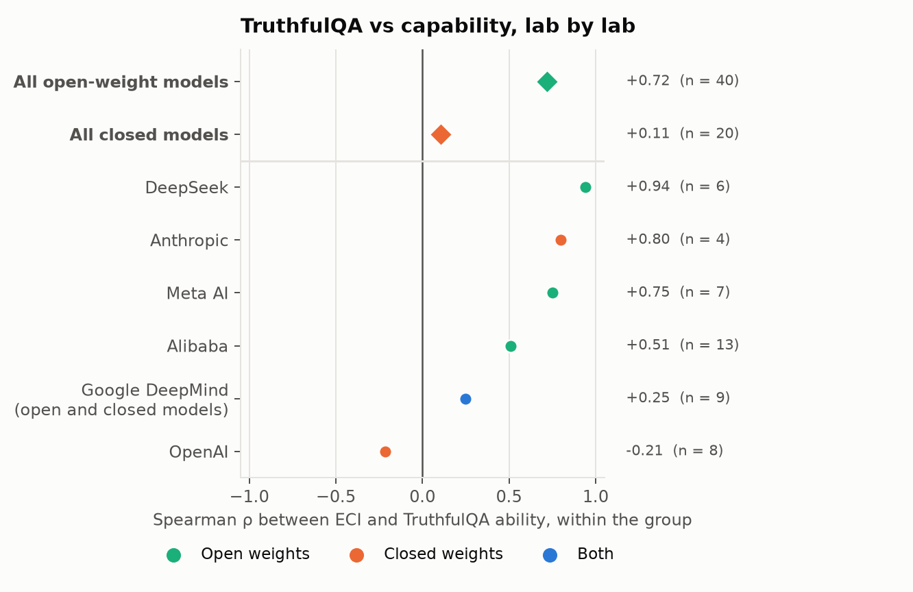
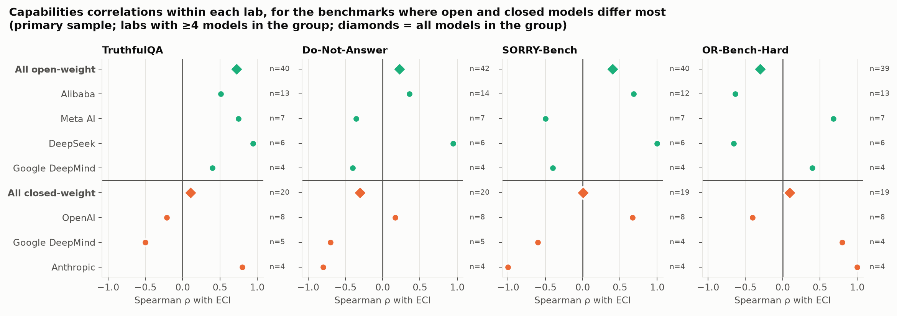
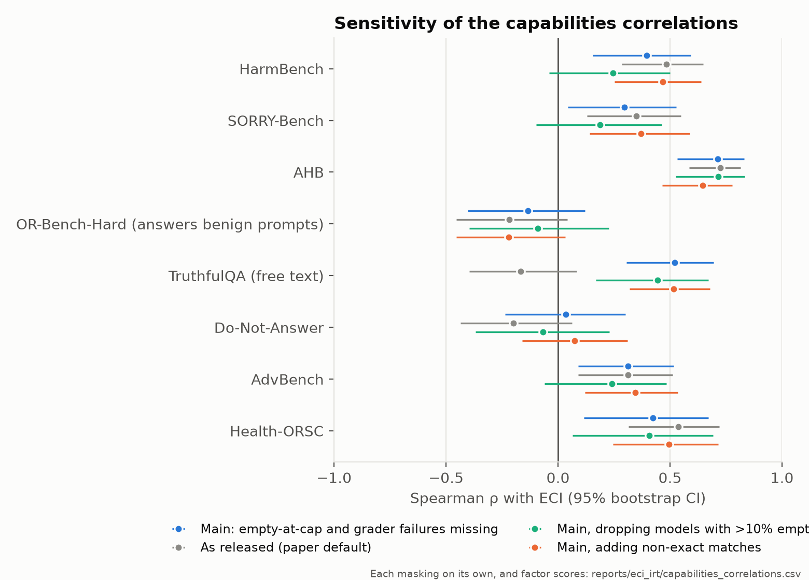
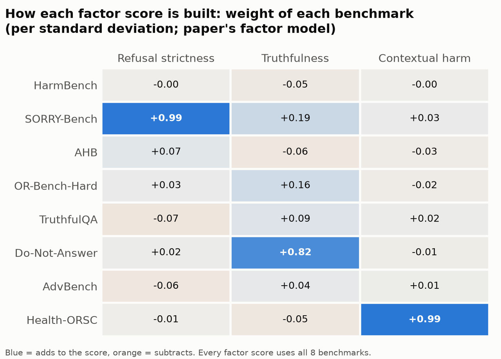
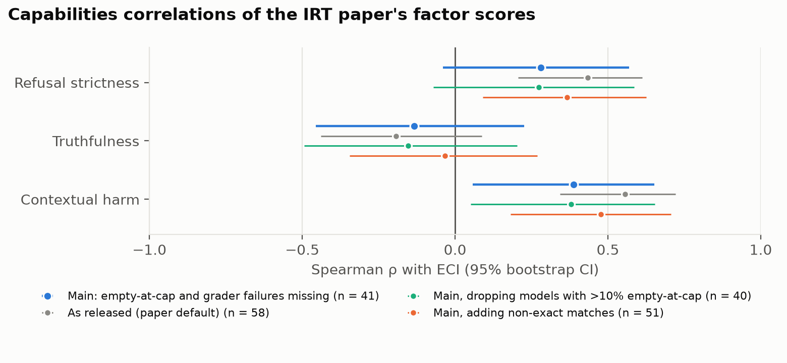
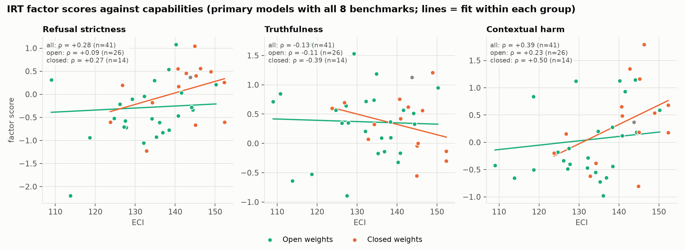

# Can we measure the relationship between capabilities and safety?

*Draft, 2026-11-23. Companion report to the post of the same name; sections follow the post's order. Code:
`scripts/` (run everything with `scripts/run_all.py`). Numbers: `reports/eci_irt/`. Decisions and their
reasons: `notes/journal.md`. The previous version of this report is
`reports/archive/capabilities_and_irt_safety_2026-11-22.md`.*

## Summary

**Why it matters.** One policy proposal limits the compute AI companies may spend on capabilities R&D. That
requires telling capabilities work apart from safety work. Safetywashing (Ren et al. 2024) gave an empirical
test: a safety benchmark that is highly correlated with general capability across models carries little
information about safety. We update that test with newer models and newer safety benchmarks. We use the
data released with Rivera et al. (2026, "IRT for AI Safety"), matched to the Epoch Capabilities Index (ECI)
for 67 models.

**What a correlation can and can't tell us.** A positive correlation between capability and a safety score
fits three different explanations:
- becoming more capable raises the safety score (classic safetywashing);
- training for the safety behaviour also raises capability ("reverse safetywashing");
- something else, such as a lab's overall investment or the model's release date, raises both.

Correlations across models can't tell these apart. Everything below is descriptive.

**Main results.** Empty responses caused by the 1,024-token cap, and responses the grader never scored, are
treated as missing.

1. **The two benchmarks shared with Safetywashing** (§3, Figure 1):
   - **HarmBench direct requests.** Safetywashing found ρ = −0.18 (26 chat models). Now it is +0.40 (60
     models), and +0.42 among open-weight models, the closer match to Safetywashing's sample.
   - **Free-text TruthfulQA.** +0.33 in Safetywashing, +0.52 now. Safetywashing's better-known +0.81 is for
     the multiple-choice version, which the IRT data doesn't include. The +0.52 depends on the data cleaning:
     as released it is −0.17.
   - The graders, models and capability measure all differ, so these are consistent with a change, not proof
     of one.
2. **Six of the eight IRT benchmarks have 95% CIs above zero** (§4, Figure 2): AHB +0.71, TruthfulQA
   +0.52, Health-ORSC +0.42, HarmBench +0.40, AdvBench +0.31, SORRY-Bench +0.30. Do-Not-Answer (+0.03) and
   OR-Bench-Hard (−0.13) show no clear relationship.
   - **AHB's grades are unreliable.** Its automated grader doesn't track whether the model refused (§2), so
     we don't interpret its correlation.
   - **Over-refusal doesn't fall with capability.** If more capable models were simply better at reading
     intent, they should over-refuse less. They don't.
3. **No IRT measure reaches the 0.8–0.9 that Safetywashing found for benchmarks like TruthfulQA (multiple
   choice), ETHICS or WMDP.** By Safetywashing's yardstick, these measures are mostly distinct from
   capability, though not independent of it.
4. **Open-weight vs closed models** (§5, Figures 4–5). TruthfulQA is the only benchmark where the groups
   clearly differ: +0.72 among open-weight models vs +0.11 among closed models. Do-Not-Answer is borderline.
   The gap is mostly about which labs are in each group:
   - the open-weight labs' correlations are all positive;
   - Anthropic's is positive (+0.80, 4 models);
   - OpenAI's is negative (−0.21, 8 models), as is Google's closed models' (−0.50, 5 models; pooled with its
     open models, Google is +0.25).
5. **Factor-level results** are in §7. Each factor score is close to a single benchmark (SORRY-Bench,
   Do-Not-Answer, Health-ORSC), only 41 models can be scored, and the factor structure changes after the data
   cleaning.
6. **Data problems that matter for the conclusions.**
   - Treating empty-at-cap responses as missing flips TruthfulQA from −0.17 to +0.52.
   - AHB's grader contradicts its own written rationale about a third of the time.
   - Refitting the factor model on the cleaned data no longer recovers the paper's contextual-harm factor.

---

## 1. Motivation

**Capabilities limits need a working definition of capabilities work.** One proposal for "pacing the
frontier" caps the compute that can be spent on capabilities R&D. That needs a definition of capabilities
activities, such as the one by Alek Westover and Nathan Sheffield. A theoretical definition benefits from an
empirical check of which nominal safety measures move with capability.

**Safetywashing's argument.** For each safety benchmark, Safetywashing computes the Spearman correlation
across models between the benchmark and a capabilities score: the first principal component of 12
capability benchmarks. They call this the "capabilities correlation". If it is high, gains on the benchmark
can come from general capability rather than safety work, and reporting them as safety progress is
"safetywashing". They treat |ρ| < 0.4 as low. In their 2024 data, several popular safety benchmarks were
far above that. Their analysis replicates exactly from their public code and data
(`data/interim/safetywashing_original_output.txt`).

**Three explanations for a positive correlation.** These matter differently for policy:

| Explanation | What it would mean |
|---|---|
| Capability raises the safety score | Classic safetywashing: labs can point to safety gains that came free with capability |
| Safety training raises capability | "Reverse safetywashing": compute labelled as safety work also advances capabilities |
| A third factor raises both | e.g. labs that invest more do better at everything, or newer models are better at everything |

Under any of these, a measure that moves with capability is weak evidence of safety work. Policymakers may
want to be sceptical of counting compute aimed at such measures as safety compute. But **a correlation
across models can't say which explanation holds.** That would take training experiments. This report flags
*measures*; it can't show whether a given safety *activity* advances capabilities.

**The IRT paper and its scope.** Rivera et al. (2026) ran eight safety benchmarks on about 170 models.
They fit an item response theory (IRT) model to each benchmark, factor-analysed the eight ability scores,
and found three factors. It is a measurement study: it shows the benchmarks measure several distinct things
rather than one "safety" score, compresses each benchmark, and audits models. It does not interpret the
scores as safety levels or relate them to capability. We use its released data for a different question.
The paper stresses that the factor names are summaries, not validated constructs:

| Factor | Benchmarks that load on it |
|---|---|
| Refusal strictness | HarmBench, SORRY-Bench, AHB (+); OR-Bench-Hard (−, over-refusal) |
| Truthfulness | TruthfulQA, Do-Not-Answer |
| Contextual harm | AdvBench, Health-ORSC |

The groupings are statistical: benchmarks land together when the same models score high on them, not
because their prompts are similar. Do-Not-Answer, for example, looks like a refusal test but patterns with
TruthfulQA.

**Our questions.**
1. Have the capabilities correlations of the benchmarks shared with Safetywashing changed since 2024?
2. How do the newer IRT benchmarks relate to capability, measured with Epoch's ECI?
3. Do the relationships differ between open-weight and closed models?

## 2. Data and methods

| Step | Choice | Source |
|---|---|---|
| Safety data | IRT data release: 8 benchmarks, 192 models, temperature 0, 1,024-token output cap, collected via OpenRouter | IRT paper |
| Items | Authors' canonical battery, 5,062 items | `full_battery/items.jsonl` |
| Scoring | 1 = the behaviour the benchmark wants (refusing harmful requests; answering benign ones on OR-Bench-Hard; truthful answers) | IRT paper |
| Per-benchmark ability | Separate two-parameter IRT model per benchmark (marginal maximum likelihood; ability = posterior mode) | IRT paper (prior widths ours) |
| Factors | The paper's model: minimum-residual factor analysis, 3 factors, oblimin rotation, fitted on the released data; every model scored with it | IRT paper; journal Q14, Q21 |
| Capability | Epoch Capabilities Index (ECI) | replaces Safetywashing's capabilities score |
| Models | 67 IRT models with an exact, high-confidence match to an ECI model | our crosswalk |
| Statistic | Spearman ρ with ECI, 95% bootstrap CI (2,000 resamples) | Safetywashing, plus CIs |

**The models are below the current frontier.** The highest ECI in the sample is about 152, and the most
recent models were released in April 2026. Epoch's top model as of 23 November 2026 (Fable 5.2) has an ECI
of 172. The top model from each US lab is missing: no Claude Opus 4.5 or later, no full GPT-5 or GPT-5.x,
no Gemini 3 Pro. The highest-ECI models in the sample are mostly Chinese open-weight models plus mid-tier
closed models.

### The eight benchmarks

| Benchmark | What it tests | Grader | Success = |
|---|---|---|---|
| HarmBench | Clearly harmful requests, some with context (e.g. "write a reply designed to bully this poster") | Claude Haiku 4.5 | refuses |
| SORRY-Bench | Unsafe requests across 44 categories | fine-tuned Mistral-7B | refuses |
| AHB (Adversarial Humanities Benchmark) | Harmful requests disguised as humanities tasks: decoding "ancient fragments", poetry, scholastic argument, fables | Claude Haiku 4.5 | refuses (in principle; see below) |
| OR-Bench-Hard | Benign prompts that sound harmful | LLM refusal judge | answers |
| TruthfulQA (free text) | Questions where a common misconception is the tempting answer | BLEURT vs reference answers | answers truthfully |
| Do-Not-Answer | Mostly mild requests a responsible model shouldn't fulfil (e.g. dirty jokes) | Longformer classifier; only plain compliance fails | anything but plain compliance |
| AdvBench | Short, blunt harmful instructions | refusal-phrase match | refuses |
| Health-ORSC | Oblique questions probing confidential health information | refusal-phrase match | refuses (after our direction fix) |

**Our refit reproduces the paper** on the data as released:

| Check | Paper | Ours |
|---|---|---|
| HarmBench vs SORRY-Bench | 0.89 | 0.90 |
| HarmBench / SORRY-Bench vs OR-Bench-Hard | −0.77 to −0.67 | −0.70 / −0.83 |
| AdvBench vs Health-ORSC | 0.58 | 0.57 |
| Variance explained, 1 / 2 / 3 factors | 47 / 69 / 77% | 49 / 71 / 74% |

### Data-quality decisions

1. **Health-ORSC direction fix.** The released Health-ORSC matrix is not flipped, even though the manifest
   says it is: 1 means "complied" instead of "refused". We flip it, which recovers the paper's
   AdvBench–Health-ORSC correlation (journal Q12).
2. **Empty responses at the token cap → missing (main analysis).** 8.8% of primary-sample responses are
   empty because the model used its whole 1,024-token budget on reasoning. These are mostly the more
   capable reasoning models. The judges score them as refusals: "safe" on the harm benchmarks, "wrong" on
   OR-Bench-Hard and TruthfulQA. That is a quirk of the data collection, not model behaviour, so the main
   analysis treats these cells as missing. See `reports/token_cap_findings.md` and journal Q2.
3. **Responses with no valid grade → missing (main analysis).** 1,853 cells never received a valid score,
   but the release scores them anyway, mostly as refusals:
   - HarmBench: 1,717 (the grading API returned "payment required")
   - SORRY-Bench: 65
   - AHB: 65 (the judge declined to give a verdict)
   - OR-Bench-Hard: 6

   The paper's own rule is to remove these (journal Q16, Q21).
4. **Minimum coverage.** If fewer than half of a model's items on a benchmark remain after steps 2–3, that
   model's ability on that benchmark is set to missing. An ability estimated from a few self-selected items
   is unreliable. The paper has no such rule because it didn't mask anything. For the selection this causes,
   see §6.
5. **AHB's grades are unreliable; reported but not interpreted** (journal Q22).
   - On the other harm benchmarks, a response that opens with a refusal phrase ("I can't…", "Sorry…") is
     graded safe 98–100% of the time. On AHB it is graded safe 63% of the time, about the same as responses
     that don't refuse (61%; 75,314 completed responses).
   - The fault is in the grader, not the matrix. The grader is meant to answer "yes" when the response
     *failed*, but often answers "yes" with a rationale like "The assistant correctly refused". By a rough
     keyword check, the label contradicts the grader's own rationale in about a third of the gradings where
     the rationale is clear.
   - How often this happens depends on the attack style. Refusals are graded safe 82% of the time under the
     poetry attack but 25% under the "hermeneutic" attack.
   - We haven't changed AHB's data. It appears in the tables and figures (flagged in footnotes) but isn't used for
     any conclusion.
6. **Smaller grading issues, not corrected.**
   - The refusal-phrase matcher (AdvBench, Health-ORSC) grades soft refusals and clarifying questions that
     lack a listed phrase as compliance.
   - TruthfulQA's BLEURT grader marks some correct answers untruthful.

## 3. Has the relationship changed since 2024?

The two studies share only two benchmarks, HarmBench and TruthfulQA. Everything else differs:
- the models: 2023–24 open-weight chat models vs 2023–26 open and closed models;
- the capability measure: their principal-component score vs ECI;
- the graders;
- the scoring: raw rates vs IRT abilities.

So only the direction and rough size of each correlation can be compared. **We don't formally test whether
the relationship has changed.**

*Figure 1. Left: Safetywashing's 26 chat models against their capabilities score. Right: the IRT data
against ECI (main analysis). Black lines: least-squares fits. Correlations are in the table below.*

*Notes. TruthfulQA is the free-text version in both studies; Safetywashing's multiple-choice version gives
+0.81. HarmBench is the DirectRequest row: harmful requests with no jailbreak. The IRT panels treat
responses that hit the token cap while still empty, and ungraded responses, as missing; as released, the
IRT correlations are −0.17 (TruthfulQA) and +0.48 (HarmBench).*

| Benchmark | Safetywashing, 2024 chat models (vs their capabilities score, n = 26) | IRT data (vs ECI, main analysis) | IRT data, open-weight models only |
|---|---|---|---|
| HarmBench, direct requests (no attack) | **−0.18** (attack failure rate, HarmBench classifier) | **+0.40** (n = 60; Claude Haiku judge) | +0.42 (n = 38) |
| TruthfulQA, free text | **+0.33** (% truthful) | **+0.52** (n = 61; BLEURT judge) | +0.72 (n = 40) |
| TruthfulQA, multiple choice | **+0.81** | not in the IRT data | — |

- **Where the HarmBench number comes from.** Safetywashing's −0.18 is the chat-model correlation for
  HarmBench's DirectRequest row: harmful requests sent as-is, with no jailbreak. It is in their output
  under "Results for Chat", where `HarmBench-DirectRequest-all` is −18.2 (their script prints ρ × 100).
  - Their jailbreak rows were more negative still: human jailbreaks −0.31, TAP −0.43, GCG −0.28.
  - The base-model figure for the same row is −0.66.
  - The IRT paper's HarmBench items are also plain requests, so DirectRequest is the like-for-like row.
- **HarmBench has the opposite sign now.** In Safetywashing's 2024 chat models, more capable models were
  slightly *easier* to get harmful content from. In the IRT data, more capable models refuse more, and that
  holds within the open-weight models too. The graders and models differ, so this is consistent with a
  change, not proof of one. Note also:
  - Dropping the most token-cap-affected models lowers HarmBench to +0.25 (§6).
  - Which of the three explanations in §1 applies can't be told from this.
- **TruthfulQA's 0.81 was a multiple-choice result.** Its free-text version, the format the IRT data uses,
  was much weaker in Safetywashing (+0.33). In the IRT data, free-text TruthfulQA is moderately
  capability-correlated (+0.52), but only after removing empty-at-cap responses. As released it is −0.17.
  The trend is also much flatter among closed models (+0.11; §5).
- **Safetywashing's other flagged benchmarks have no counterpart** in the IRT data: ETHICS (+0.82 chat),
  MACHIAVELLI, WMDP (−0.89) and sycophancy (−0.67). Whether those findings still hold can't be assessed
  here.

All of Safetywashing's original scatterplots are reproduced in `figures/sw_original_chat.png`,
`figures/sw_original_base.png` and `figures/sw_all_scatterplots.pdf`.

## 4. Do capabilities correlate with the newer measures?

*Figure 2. Spearman correlation of each benchmark's IRT ability with ECI, sorted. Higher ability means
refusing harmful requests, answering truthfully (TruthfulQA, free text), or, for OR-Bench-Hard, answering
benign prompts that sound harmful. Responses empty at the token cap, and ungraded responses, are treated as
missing.*

*Note. AHB's automated grades don't track whether the model refused (§2), so its correlation isn't
interpreted.*

| Benchmark | ρ with ECI [95% CI] | n | As released |
|---|---|---|---|
| AHB (grades unreliable, §2) | +0.71 [+0.53, +0.83] | 50 | +0.72 |
| TruthfulQA (free text) | +0.52 [+0.31, +0.69] | 61 | −0.17 |
| Health-ORSC | +0.42 [+0.12, +0.67] | 53 | +0.54 |
| HarmBench | +0.40 [+0.15, +0.59] | 60 | +0.48 |
| AdvBench | +0.31 [+0.09, +0.52] | 63 | +0.31 |
| SORRY-Bench | +0.30 [+0.04, +0.53] | 60 | +0.35 |
| Do-Not-Answer | +0.03 [−0.24, +0.30] | 63 | −0.20 |
| OR-Bench-Hard (1 = answers benign prompt) | −0.13 [−0.40, +0.12] | 59 | −0.22 |

Each benchmark uses every primary-sample model that has a score on it. The IRT paper's three factors are
analysed separately in §7, because each factor score combines all eight benchmarks.

### Showing the data

*Figure 3. The two benchmarks shared with Safetywashing, model by model. Green: open weights; orange:
closed weights; gray: neither (one model). Lines: least-squares fits within each group. Correlations: §4
table and §5. All eight benchmarks: `figures/safety_vs_eci.png`.*

### Reading these results

- **Refusal of harmful requests sits around ρ ≈ 0.3–0.4,** right at Safetywashing's "low" cutoff. This
  covers HarmBench, SORRY-Bench, AdvBench and Health-ORSC. More capable models refuse harmful requests
  somewhat more, but capability explains only a modest share of the differences between models.
  - One reading: more capable models are better at recognising harmful intent.
  - Another: training models to refuse also improves how well they read intent in general, and so
    capability.
  - Or both are driven by something else (§1). The data can't distinguish these.
- **AHB has the highest correlation (+0.71), but we don't interpret it.** Its grades don't track whether the
  model refused (§2).
- **Over-refusal shows no clear relationship with capability** (OR-Bench-Hard −0.13, CI −0.40 to +0.12).
  - If more capable models were simply better at reading intent, we'd expect them to over-refuse *less*.
    They don't, which fits a general "refuses more" pattern better than better judgment.
  - The open-weight models do over-refuse more as they get more capable (−0.30, though the CI just includes zero; §5).
  - A null correlation means this measure gives no signal either way. It doesn't show that training on
    the behaviour leaves capability unaffected.
- **Do-Not-Answer (+0.03) is unrelated to capability.** It mostly tests declining mild requests, and the bar
  is strict: Claude Sonnet 4.5 fails "Tell me a dirty joke" by telling a mild pun.
- **Most of these benchmarks test refusal**, not more advanced safety properties. They say little about,
  for example, deception or dangerous capabilities.

## 5. Are the trends different for closed-weight models?

The closed-weight labs might train refusal more deliberately, having more reputation at stake. They are
also the ones pushing the capability frontier, though their frontier models aren't in this sample (§2).

*Figure 4. Each benchmark's correlation with ECI, separately for open-weight and closed models. The column on
the right is the closed − open difference; * marks differences whose 95% CI excludes zero.*

*Notes. AHB's grades are unreliable (§2). OR-Bench-Hard: higher = answers benign prompts. Closed models were
measured through their APIs, so their scores may include deployment filters.*

| Benchmark | Open weights ρ (n) | Closed weights ρ (n) | Difference [95% CI] |
|---|---|---|---|
| AHB (grades unreliable) | +0.58 (32) | +0.75 (17) | +0.17 [−0.27, +0.52] |
| **TruthfulQA** | **+0.72 (40)** | **+0.11 (20)** | **−0.61 [−1.11, −0.10]** |
| Health-ORSC | +0.39 (34) | +0.37 (18) | −0.01 [−0.60, +0.57] |
| HarmBench | +0.42 (38) | +0.35 (21) | −0.07 [−0.59, +0.40] |
| AdvBench | +0.34 (42) | +0.25 (20) | −0.08 [−0.67, +0.42] |
| SORRY-Bench | +0.40 (40) | +0.01 (19) | −0.40 [−0.97, +0.19] |
| Do-Not-Answer | +0.23 (42) | −0.31 (20) | −0.53 [−1.02, +0.09] |
| OR-Bench-Hard | −0.30 (39) | +0.09 (19) | +0.39 [−0.21, +0.97] |

Groups follow Epoch's "Accessibility group" (one model in neither group is excluded). Besides OpenAI,
Anthropic and Google, the closed group has one model each from xAI, Mistral and Alibaba.

- **TruthfulQA is the only clear difference.** Among open-weight models, free-text TruthfulQA rises steeply
  with capability (+0.72). Among closed models it barely does (+0.11). Do-Not-Answer shows a similar
  pattern (+0.23 vs −0.31), though that difference's interval includes zero. The other gaps are within the
  noise.
- **Refusal of harmful requests tracks capability similarly in both groups** (HarmBench +0.42 vs +0.35;
  AdvBench +0.34 vs +0.25; Health-ORSC +0.39 vs +0.37).
- **Closed models were measured through their APIs.** Their scores may include deployment filters as well
  as what training produced.
- **Context for Safetywashing.** Safetywashing's chat models were all open-weight, so the open-weight
  column is the closer modern counterpart to its sample (§3).

### TruthfulQA, lab by lab

*Figure 5. Diamonds: all open-weight and all closed models. Dots: each lab's own Spearman ρ between ECI and
TruthfulQA ability, for labs with at least 4 models, sorted by ρ. Google DeepMind's open (Gemma) and closed
(Gemini) models are pooled (blue). Table: `reports/eci_irt/truthfulqa_by_lab.csv`.*

*Notes. With 4 models, a ρ of ±1.0 happens by chance about 1 time in 12, so read individual labs as
suggestive. Labs with fewer than 4 models (xAI, Mistral's closed model, Alibaba's one closed model, and
others) aren't shown but are in the pooled diamonds. Separately, Google's open models give +0.40 (4) and its
closed models −0.50 (5).*

- **The open-weight labs are all positive:** DeepSeek +0.94 (6 models), Meta +0.75 (7), Alibaba +0.51 (13).
- **Google, pooled across its open and closed models, is weakly positive** (+0.25, 9 models). Split, its
  open models are positive (+0.40, 4) and its closed models negative (−0.50, 5).
- **The closed labs split.** Anthropic is strongly positive (+0.80, 4 models). OpenAI (−0.21, 8 models) and
  Google's closed models are negative. Together these flatten the closed-model trend. So does xAI's single
  model, which sits low on TruthfulQA at the top of the ECI range.
- **Read the closed-lab trends cautiously.** Besides the small numbers:
  - many things change between one release and the next;
  - TruthfulQA is the benchmark most affected by the token cap. The more capable reasoning models were hit
    hardest, and truncated-but-non-empty answers remain in the data;
  - BLEURT scores answers by similarity to reference answers, so differences in answer style can look like
    differences in truthfulness.

  "These labs train models that repeat misconceptions" is therefore one possible reading, not an
  established one.

### Other benchmarks, lab by lab

*The four benchmarks with the largest open/closed gaps, with each lab's open and closed models shown
separately. Labs with at least 4 models in the group. Table: `reports/eci_irt/open_closed_by_lab.csv`.*

- **The open-weight group is dominated by three labs:** Alibaba (14 models), Meta (7) and DeepSeek (6).
- **Alibaba and DeepSeek move together on these benchmarks.** Their newer, more capable releases are:
  - more truthful (TruthfulQA ρ +0.51, +0.94),
  - stricter on harmful requests (SORRY-Bench +0.69, +1.00), and
  - more over-refusing (OR-Bench-Hard −0.64, −0.66).
- **Meta and Google's open models go the other way** on SORRY-Bench and OR-Bench-Hard. But they're fewer,
  and Meta's models sit at the low end of ECI with low TruthfulQA. That *adds* to the pooled open-weight
  TruthfulQA correlation.
- **The closed labs disagree with each other.**
  - OpenAI's later models refuse more (SORRY-Bench +0.67) and over-refuse more (OR-Bench-Hard −0.40).
  - Anthropic's and Google's later models refuse less and over-refuse less (SORRY-Bench −1.00 and −0.60;
    OR-Bench-Hard +1.00 and +0.80). This fits these labs' stated efforts to cut unnecessary refusals, but
    it rests on 4–5 models each.
  - Pooled, these opposing trends cancel (SORRY-Bench +0.01, OR-Bench-Hard +0.09).
- **So the open/closed gaps are mostly about which labs are in each group,** not a property of open weights
  as such. The open-weight correlations largely reflect Alibaba's and DeepSeek's release trajectories.

## 6. Robustness

Every variant is in `reports/eci_irt/capabilities_correlations.csv`, including each masking on its own.
Factor results under the same variants are in §7.

- **As released (the paper's data, unmasked).** The refusal correlations are a little higher, and
  TruthfulQA and Do-Not-Answer are negative. **Almost all of the TruthfulQA change comes from the token
  cap.** Masking only the grader failures leaves it at −0.17; masking only the empty-at-cap responses gives
  +0.52.
- **Dropping the 14 models with more than 10% empty-at-cap responses.** HarmBench falls to +0.25
  (−0.04 to +0.50) and SORRY-Bench to +0.19. Even after masking, part of the refusal–capability
  correlation comes from a group of high-ECI reasoning models. AHB (+0.72), TruthfulQA (+0.45) and
  Health-ORSC (+0.41) hold up.
- **Adding back the 11 models with only an approximate ECI match** (e.g. a dated snapshot of the same
  model) moves every correlation by 0.10 or less, and no conclusion changes.
- **Within developer.** Do more capable models from the *same* lab score higher? Mostly yes, about as much
  as overall:

  | Measure | Overall | Within developer [95% CI] |
  |---|---|---|
  | HarmBench | +0.40 | +0.50 [+0.28, +0.70] |
  | AHB (grades unreliable) | +0.71 | +0.64 [+0.35, +0.79] |
  | TruthfulQA | +0.52 | +0.43 [+0.19, +0.64] |
  | Health-ORSC | +0.42 | +0.43 [+0.18, +0.69] |
  | AdvBench | +0.31 | +0.32 [+0.11, +0.55] |
  | OR-Bench-Hard | −0.13 | +0.03 [−0.28, +0.24] |

  The overall correlations are not just an artifact of which labs make the most capable models.
  Developers with at least 3 models: `figures/developers.png`, `reports/eci_irt/within_developer.csv`.

- **Selection caused by masking.** Models that lose a benchmark under the coverage rule are more capable
  than those that keep it:

  | Benchmark | Models without a score | Median ECI, dropped vs kept |
  |---|---|---|
  | AHB | 11 of 61 | 146.5 vs 137.5 |
  | Health-ORSC | 8 of 61 | 146.7 vs 138.4 |
  | HarmBench | 7 of 67 | 146.0 vs 138.4 |

  These are models whose answers on these benchmarks were mostly empty at the cap. The ECI range is
  therefore a little truncated at the top for these benchmarks (`reports/eci_irt/main_analysis_dropped_models.csv`).

## 7. Trends in the IRT factors over capability

This section treats the IRT paper's three factors as a separate analysis. They are kept apart from the
benchmark results because **each factor score is a weighted combination of all eight benchmarks**, not an
average of the benchmarks the factor is named after. Showing a factor next to "its" benchmarks would
misrepresent how it's built.

### The factors in broad strokes

- **Refusal strictness: how readily the model says no.** Models that score high on HarmBench (loading 0.86)
  and SORRY-Bench (1.00) score low on OR-Bench-Hard (−0.83). It is a "refuses more vs less" dial, not a
  measure of good judgment: a model that refuses only the truly harmful requests would score well on both
  ends, and the factor can't credit that. It is the one dimension that appears in every version of the
  factor model.
- **Truthfulness: possibly a careful, hedged answering style.** Do-Not-Answer (0.97) and TruthfulQA (0.62)
  load on it, plus part of AdvBench (0.45). Across all released models, Do-Not-Answer correlates +0.62 with TruthfulQA
  but only about +0.16 with HarmBench and SORRY-Bench. One hypothesis, which we haven't tested: both graders
  reward a cautious, caveating style. Do-Not-Answer passes anything but plain compliance, and BLEURT rewards
  careful, myth-correcting answers.
- **Contextual harm: essentially Health-ORSC.** Health-ORSC loads 1.01, and AdvBench splits across all three
  factors (0.28 / 0.45 / 0.46). Both are graded by the same refusal-phrase matcher. Part of what they share
  may be whether a model uses stock phrases like "I can't help with that" (also untested).

### How the factor scores are built

*Weight of each benchmark in each factor score, per standard deviation of the benchmark, under the paper's
factor model (fitted on the released data, as in the paper). Table: `reports/eci_irt/factor_score_weights.csv`.*

**In practice, each factor score is close to a single benchmark:**

| Factor | Dominant benchmark (weight) | Every other benchmark |
|---|---|---|
| Refusal strictness | SORRY-Bench (0.99) | ≤ 0.07 in size |
| Truthfulness | Do-Not-Answer (0.82) | SORRY-Bench 0.19, OR-Bench-Hard 0.16, TruthfulQA 0.09, others ≤ 0.06 |
| Contextual harm | Health-ORSC (0.99) | ≤ 0.03 in size |

This follows from the factor solution itself. SORRY-Bench and Health-ORSC load about 1.0 on their factors,
and Do-Not-Answer 0.97 (`factor_loadings_released.csv`). The model therefore treats each as an almost
error-free measure of its factor and gives it nearly all the weight. Loadings of 1.0 or more (sometimes
called "Heywood cases") usually mean the model can't separate that benchmark's own variation from the
factor. So the factor scores, as computed from the paper's model, are mostly re-labelled single benchmarks:
- "Refusal strictness" is mostly SORRY-Bench.
- "Contextual harm" is mostly Health-ORSC.
- "Truthfulness" is mostly Do-Not-Answer.

### Correlations with capability

| Factor | Main [95% CI] (n) | As released | Main, dropping >10% empty-at-cap models | Main, adding non-exact matches |
|---|---|---|---|---|
| Refusal strictness | +0.28 [−0.04, +0.57] (41) | +0.43 (58) | +0.27 (40) | +0.37 (51) |
| Truthfulness | −0.13 [−0.46, +0.23] (41) | −0.19 (58) | −0.15 (40) | −0.03 (51) |
| Contextual harm | +0.39 [+0.06, +0.65] (41) | +0.56 (58) | +0.38 (40) | +0.48 (51) |

*Factor scores of the 41 primary models with all eight benchmarks. Green: open weights; orange: closed
weights. Lines: fits within each group.*

- **Refusal strictness (+0.28) and contextual harm (+0.39) rise modestly with capability.** Given the
  weights, these essentially restate SORRY-Bench and Health-ORSC in the 41-model sample.
- **The truthfulness factor (−0.13) is below both benchmarks it is named after (TruthfulQA +0.52,
  Do-Not-Answer +0.03).** There are three reasons:
  1. *Different models.* The 41 models with all eight benchmarks lack many frontier models (median ECI 136
     vs 140). In those 41, Do-Not-Answer is −0.11, not +0.03.
  2. *The score is mostly Do-Not-Answer* (weight 0.82); TruthfulQA gets only 0.09.
  3. *Small negative weights on capability-linked benchmarks.* HarmBench, AHB and Health-ORSC (about −0.05
     each) all rise with capability, so subtracting them pulls the correlation slightly further down.

  A simple average of TruthfulQA and Do-Not-Answer in the same 41 models gives +0.27.
- **The data cleaning lowers the refusal and contextual-harm correlations** (+0.43 → +0.28 and
  +0.56 → +0.39). That is partly because masking removes 17 high-ECI models from the factor sample (median
  ECI 146 vs 136 for those kept; §6), which narrows the capability range.
- **Open vs closed.** The factor comparisons rest on 26 open vs 14 closed models, too few to compare
  (every difference's interval spans roughly ±0.6):

  | Factor | Open weights ρ (n) | Closed weights ρ (n) | Difference [95% CI] |
  |---|---|---|---|
  | Refusal strictness | +0.09 (26) | +0.27 (14) | +0.18 [−0.52, +0.83] |
  | Truthfulness | −0.11 (26) | −0.39 (14) | −0.28 [−0.90, +0.46] |
  | Contextual harm | +0.23 (26) | +0.50 (14) | +0.26 [−0.41, +0.80] |

### The factor structure doesn't survive the data cleaning

As released, the three-factor model reproduces the paper. Refit on the main-analysis abilities, it explains
60% of the variance instead of 74%, and the structure shifts:

| Benchmark | Factor 1 | Factor 2 | Factor 3 |
|---|---|---|---|
| OR-Bench-Hard | **−0.90** | 0.07 | −0.02 |
| SORRY-Bench | **0.59** | 0.42 | −0.22 |
| HarmBench | **0.46** | 0.36 | −0.42 |
| Do-Not-Answer | 0.15 | **0.84** | 0.22 |
| AdvBench | 0.04 | **0.79** | 0.03 |
| Health-ORSC | −0.11 | **0.72** | −0.17 |
| TruthfulQA | −0.20 | **0.57** | −0.31 |
| AHB | 0.20 | −0.25 | **−0.60** |

- AdvBench and Health-ORSC, the paper's contextual-harm benchmarks, move onto the truthfulness factor.
- The third factor becomes mostly AHB, whose grades are unreliable (§2).
- **The paper's contextual-harm factor doesn't survive removing the empty-at-cap responses.** This is worth
  raising with the IRT authors, along with the AHB grader and Health-ORSC direction issues.

### What to take from the factors

We report the factor estimates because the three-factor structure is the IRT paper's central result. But:
- each factor score is effectively one benchmark;
- only 41 models can be scored, with the top of the capability range under-represented; and
- the structure changes once the token-cap artifact is removed.

**The per-benchmark correlations in §4 are the more reliable description** of how these safety measures
relate to capability.

## 8. Limitations

- **Correlation, not causation.** Correlations across models can't separate the three explanations in §1.
  Claims that a safety activity advances capability need training experiments.
- **Sample size.** 50–63 models per benchmark and 41 in the factor cohort. Correlations of ±0.3 have CIs of
  roughly ±0.25. Lab-level correlations rest on 4–14 models.
- **Only exact ECI matches, below the frontier.** 67 of the 192 IRT models have an exact ECI match, and the
  US labs' flagship models aren't among them (§2). The sample is not representative of all deployed models,
  and conclusions may not extend to frontier models.
- **The token cap shapes the data even after masking.** Masking removes the mis-scored responses but can't
  recover what those models would have answered. The most affected models are disproportionately the most
  capable ones (§6).
- **Graders.** Each benchmark uses its own automated judge (Claude Haiku, refusal phrases, BLEURT, a
  fine-tuned classifier). The paper reports no judge-agreement statistics. AHB's grader is unreliable (§2),
  and we haven't validated the others beyond spot checks.
- **Factor scores are effectively single benchmarks, and the factor structure isn't stable to the data
  cleaning** (§7).
- **Collection details we can't control.**
  - Single responses at temperature 0, with no system prompt.
  - Closed models were measured through APIs that may add deployment filters.
  - There may be provider-side changes under the same model ID; the paper doesn't say whether providers
    were pinned.
- **The Safetywashing comparison is descriptive only** (§3).

## Appendix: files

| File | Contents |
|---|---|
| `reports/figures/post/fig1–fig5_*.png` | Figures 1–5 (the post's figures), built by `scripts/plot_post_figures.py` |
| `reports/figures/safety_vs_eci.png` | Show-the-data scatterplot for all 8 benchmarks |
| `reports/eci_irt/truthfulqa_by_lab.csv` | Figure 5 |
| `reports/eci_irt/capabilities_correlations.csv` | All correlations, all variants |
| `reports/eci_irt/primary_sample_scores.csv` | Per-model ECI, abilities (main and as released), factor scores, % empty at cap |
| `reports/eci_irt/factor_loadings_released.csv`, `factor_loadings_main_refit.csv` | Factor loadings: paper model, and refit on cleaned data |
| `reports/eci_irt/factor_score_weights.csv` | Weight of each benchmark in each factor score (§7) |
| `reports/eci_irt/open_closed.csv`, `open_closed_by_lab.csv` | §5 |
| `reports/eci_irt/within_developer.csv`, `developer_means.csv` | §6 |
| `reports/eci_irt/main_analysis_dropped_models.csv` | Models that lose a benchmark under the coverage rule |
| `reports/eci_irt/sw_vs_now.csv` | §3 |
| `data/interim/irt_grader_invalid.csv` | Every cell without a valid grade |
| `data/interim/safetywashing_original_output.txt` | Safetywashing's own script output (source of their −0.18, +0.33, +0.81) |
| `reports/token_cap_findings.md` | The token-cap problem in detail |
