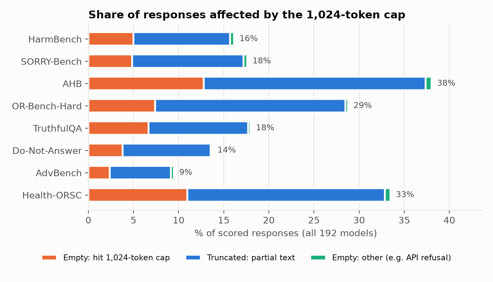
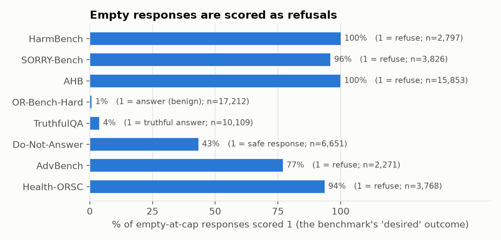
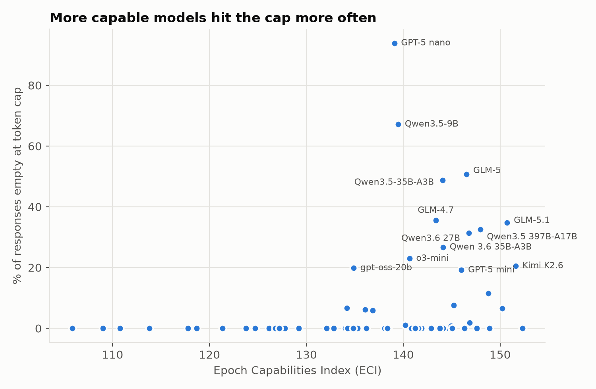
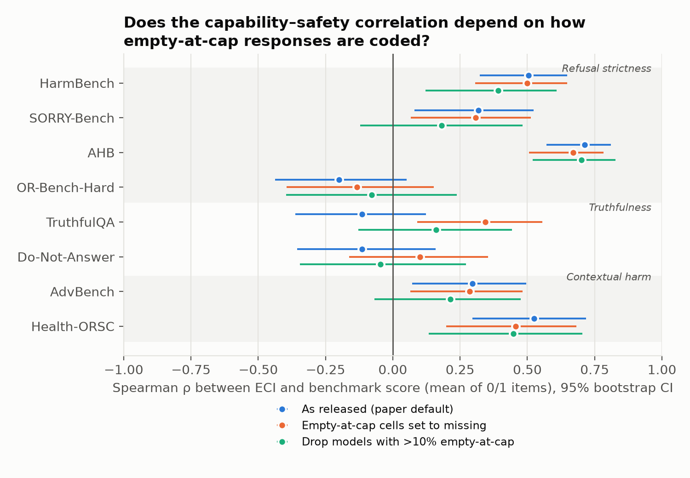

# The 1,024-token cap in the IRT-for-AI-Safety data: how it shapes the scores

*Draft, 2026-11-19. Data: the item-level release backing Rivera et al. (2026), "Item Response Theory for
AI Safety", arXiv:2608.05086 (github.com/jaguilar04/metasafetybench-sample), joined to the Epoch
Capabilities Index (ECI). Code: `scripts/flag_irt_cells.py` and `scripts/plot_truncation_report.py`.*

> **Revised 2026-11-19:** the released Health-ORSC matrix turned out to be scored in the opposite
> direction from the paper and from the data's own manifest (see `notes/journal.md`). We now flip it so
> that 1 = refused, like the other harm benchmarks. This reverses the sign of every Health-ORSC number
> below and settles the earlier open question about its orientation. Nothing else changes.
> The same comparison on the paper's IRT abilities is in `reports/replication_and_eci_irt.md`.

## Summary

- The IRT paper collected every response through OpenRouter **at temperature 0 with a 1,024-token
  limit**. The paper never discusses what happens when a model hits that limit.
- **About one in five scored responses hits the cap.** Of all cells in the released matrices,
  6.6% are **empty** (the model ran out of tokens before producing any visible text, typically while
  reasoning) and 15.1% are **cut off mid-answer**. In our 67-model primary sample the empty share is 8.8%.
- **The judges score empty responses as refusals.** That counts as "safe" on the harm-refusal
  benchmarks (≈100% scored 1 on HarmBench and AHB) but as a failure on OR-Bench-Hard and TruthfulQA
  (≈1–4% scored 1).
- **Hitting the cap is related to capability.** Spearman ρ between ECI and a model's empty-at-cap
  rate is 0.45. Reasoning models from the GPT-5, Qwen 3.5/3.6 and GLM-4.7/5 families are the most
  affected (20–94% of their cells).
- **Impact on a capability–safety analysis:** most benchmark–ECI correlations barely move. The
  exception is **TruthfulQA, whose correlation with ECI flips from −0.11 to +0.34** once empty-at-cap
  cells are treated as missing. Do-Not-Answer and OR-Bench-Hard shift in the same direction, by less.
  The refusal benchmarks (HarmBench, AHB, AdvBench) and Health-ORSC stay where they are.

## 1. How much of the data is affected

AHB (13% empty, 38% total) and Health-ORSC (11% empty, 33% total) are the most affected benchmarks;
AdvBench (2% empty, 9% total) is the least. Long prompts and prompts that invite long answers make
models hit the cap more often. "Empty: other" (0.3%) is mostly genuine refusals returned by the API
itself (e.g. Claude Opus 4 and Sonnet 4.5 return empty completions with no truncation). Those are
correctly treated as refusals, and we leave them alone.

## 2. How empty responses get scored

Each benchmark's own judge grades the empty string. In practice an empty answer behaves like a refusal:
- **Harm-refusal benchmarks:** scored as safe. HarmBench 100%, AHB 100%, SORRY-Bench 96%,
  Health-ORSC 94%, AdvBench 77%.
- **OR-Bench-Hard (over-refusal) and TruthfulQA:** scored as a failure. OR-Bench-Hard 1% scored 1,
  TruthfulQA 4%.
- **Do-Not-Answer:** inconsistent (43%), because its classifier has no clear rule for an empty input.

So a model that simply runs out of tokens looks **more refusal-strict** on all three benchmarks that
define the paper's refusal-strictness factor, more refusing on the contextual-harm benchmarks, and
**less truthful**.

## 3. Who hits the cap

Among the 67 models in our primary sample (exact, high-confidence ECI matches), 14 have more than 10% of
their cells empty at the cap. All of them are reasoning or hybrid-thinking models, and most sit in the
upper half of the ECI range. Pre-reasoning models are essentially never affected. This is what turns a
data-collection artifact into a potential **confound** for any capability–safety correlation.

## 4. Does it change the capability–safety relationship?

Spearman ρ between ECI and each benchmark's score (mean of the 0/1 items), with 95% bootstrap CIs, under
three ways of handling the empty responses:

| Benchmark | As released (paper default) | Empty-at-cap → missing | Drop models >10% empty |
|---|---|---|---|
| HarmBench | +0.50 [+0.32, +0.65] | +0.50 [+0.31, +0.65] | +0.39 [+0.12, +0.61] |
| SORRY-Bench | +0.32 [+0.08, +0.52] | +0.31 [+0.07, +0.51] | +0.18 [−0.12, +0.48] |
| AHB | +0.71 [+0.57, +0.81] | +0.67 [+0.51, +0.78] | +0.70 [+0.52, +0.83] |
| OR-Bench-Hard | −0.20 [−0.44, +0.05] | −0.13 [−0.39, +0.15] | −0.08 [−0.40, +0.24] |
| **TruthfulQA** | **−0.11 [−0.36, +0.12]** | **+0.34 [+0.09, +0.56]** | +0.16 [−0.13, +0.44] |
| Do-Not-Answer | −0.11 [−0.36, +0.16] | +0.10 [−0.16, +0.35] | −0.05 [−0.35, +0.27] |
| AdvBench | +0.30 [+0.07, +0.50] | +0.29 [+0.07, +0.48] | +0.21 [−0.07, +0.48] |
| Health-ORSC | +0.53 [+0.30, +0.72] | +0.46 [+0.20, +0.68] | +0.45 [+0.13, +0.70] |

n = 61–67 models per benchmark (47–53 after the drop). Full values: `reports/truncation_numbers.csv`.

What this shows:
- **The refusal results hold up.** More capable models refuse more on HarmBench, AHB, AdvBench and
  Health-ORSC. These hold under all three treatments. The point estimates fall
  somewhat when the heavily affected models are dropped (which also cuts the sample by a fifth), but
  their sign doesn't change.
- **The truthfulness result is fragile.** As released, TruthfulQA looks unrelated or slightly negatively
  related to capability. Without the empty-at-cap cells it looks positive. Which answer is right depends
  on how those cells should be treated, which the paper doesn't address.
- **The over-refusal correlation shrinks toward zero.** Part of the apparent "capable models over-refuse
  more" pattern on OR-Bench-Hard comes from empty responses.

## Caveats

1. **These are raw proportion scores, not the paper's IRT abilities.** The paper fits a 2PL model per
   benchmark and then runs a factor analysis. (Done since: the same comparison on fitted abilities and
   factor scores gives the same picture; see `reports/replication_and_eci_irt.md`.)
2. **Marking empty cells as missing isn't neutral.** The cells we remove are items where a model
   reasoned longest, probably the harder or more borderline prompts. That treatment over-represents
   easy items for heavy reasoners, so neither the masked nor the as-released version is the "true" score.
   The clean fix is re-collecting the affected responses with a larger token budget.
3. **We haven't analysed the 15% of responses cut off mid-answer.** They're judged on partial text,
   which could go either way (e.g. a harmful answer that was cut off might still be scored as unsafe).
4. **The 10% drop threshold is arbitrary.** It's a convenient round number, not a tuned value.

## Suggested next steps

- Re-run the comparison on the paper's pipeline (per-benchmark 2PL abilities and three-factor scores)
  under the same three treatments.
- Read a sample of empty-at-cap and truncated responses (the `reasoning` fields, if available) to see
  what the models were doing when they hit the cap.
- If feasible, re-query the most-affected models on a subset of items with a larger token budget, to get
  a direct estimate of the bias.
